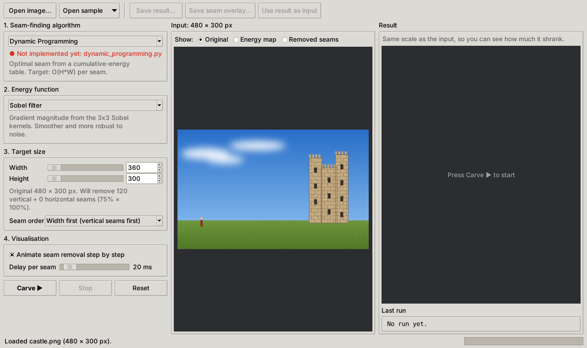

# Seam Carving: Content-Aware Image Resizing

**Assignment 2, Team T21.** Image compression by seam carving, implemented with
**Dynamic Programming**, a **Greedy Algorithm** and **Graph Cut (min-cut / max-flow)**, and
compared on visual quality, seam cost and running time.

[](https://github.com/0renfred0/T21-2400685-2400820-2400859-2401021-2401240-2400565-Assg2/actions/workflows/ci.yml)



---

## Contents

1. [Team](#team)
2. [Assignment coverage](#assignment-coverage)
3. [Quick start](#quick-start)
4. [Using the app](#using-the-app)
5. [Command-line tools](#command-line-tools)
6. [Project structure](#project-structure)
7. [Implementing a seam finder (for team members)](#implementing-a-seam-finder-for-team-members)
8. [Testing](#testing)
9. [Continuous integration](#continuous-integration)
10. [Design notes](#design-notes)
11. [Report and submission checklist](#report-and-submission-checklist)
12. [References](#references)
13. [AI usage declaration](#ai-usage-declaration)

---

## Team

| SIT ID  | Name  | Responsibility |
|---------|-------|----------------|
| 2400685 | _TBD_ | _TBD_ |
| 2400820 | _TBD_ | _TBD_ |
| 2400859 | _TBD_ | _TBD_ |
| 2401021 | _TBD_ | _TBD_ |
| 2401240 | _TBD_ | _TBD_ |
| 2400565 | _TBD_ | _TBD_ |

Suggested work packages: **Dynamic Programming**, **Greedy**, **Graph Cut**, **analysis and
benchmarks**, **report and Q2 answers**, **presentation and video**. Everyone should be able to
explain every part, because the project quiz (Week 13) is based on this code and the report.

---

## Assignment coverage

| Item | Requirement | Where | Status |
|------|-------------|-------|--------|
| 1a | Energy map (gradient / Sobel) | [`seam_carving/energy.py`](seam_carving/energy.py) | ✅ Done |
| 1b | DP minimum seam, vertical **and** horizontal | [`algorithms/dynamic_programming.py`](seam_carving/algorithms/dynamic_programming.py). Horizontal seams come from the carver (transposition) | ⬜ TODO |
| 1c | Remove the seam, recompute, repeat | [`seam_carving/carver.py`](seam_carving/carver.py) | ✅ Done |
| 2  | Questions: exponential seams, subproblems, divide and conquer | Report. Brute-force seam counter in [`tests/helpers.py`](tests/helpers.py) | ⬜ TODO |
| 3  | Greedy algorithm and comparison with DP | [`algorithms/greedy.py`](seam_carving/algorithms/greedy.py) and [`benchmark.py`](seam_carving/benchmark.py) | ⬜ TODO |
| 4  | Graph cut (min-cut / max-flow) and comparison with DP | [`algorithms/graph_cut.py`](seam_carving/algorithms/graph_cut.py) and [`benchmark.py`](seam_carving/benchmark.py) | ⬜ TODO |
| 5  | Analysis: complexity, comparison, improvements | Report. Data from `python -m seam_carving.benchmark` | ⬜ TODO |
| 7a | **Bonus**: step-by-step visualisation, all seams shown | GUI animation, *Removed seams* view, `cli.py --gif` | ✅ Done |
| 7b | **Bonus**: interactive resizing | GUI sliders, *Use result as input* | ✅ Done |
| 7c | **Bonus**: CI/CD | [`.github/workflows/ci.yml`](.github/workflows/ci.yml) | ✅ Done |
| 8  | Presentation video (YouTube link in the report) | | ⬜ TODO |
| 9  | Report (team ID, SIT IDs, links, AI declaration) | XSite Dropbox | ⬜ TODO |

The GUI, energy maps, carving loop, visualisation, benchmarks, tests and CI are working. The
three seam finders are **stubs** with step-by-step comments. Until one is implemented, the app
reports it as "not implemented yet" and its tests are skipped.

---

## Quick start

You need **Python 3.10 or newer**. Tkinter comes with the python.org installers for Windows
and macOS. On Debian/Ubuntu, run `sudo apt install python3-tk`.

```bash
git clone https://github.com/0renfred0/T21-2400685-2400820-2400859-2401021-2401240-2400565-Assg2.git
cd T21-2400685-2400820-2400859-2401021-2401240-2400565-Assg2
python -m venv .venv
```

Activate the virtual environment.

| OS | Command |
|----|---------|
| Windows (PowerShell) | `.venv\Scripts\Activate.ps1` |
| macOS / Linux | `source .venv/bin/activate` |

Then install the dependencies and start the app.

```bash
pip install -r requirements-dev.txt
python main.py
```

`python main.py samples/castle.png` opens the app with an image already loaded.

---

## Using the app

1. **Open an image** (`Ctrl+O`), or pick one from **Open sample**. Images larger than 1000 px
   can be downscaled to 800 px on load, because seam carving recomputes everything for every
   seam.
2. **Choose the algorithm** from the dropdown: *Dynamic Programming*, *Greedy Algorithm* or
   *Graph Cut*. The label under it shows whether that algorithm is implemented yet.
3. **Choose the energy function**: *Sobel filter* or *Gradient magnitude (L1)*.
4. **Set the target width and height** with the sliders or the number boxes. You can also pick
   the **seam order**: width first, height first, or interleaved.
5. Press **Carve ▶** (`F5`). With *Animate* on, the right pane shows every seam (yellow) just
   before it is removed. Use the *Delay per seam* slider to slow the animation down for the
   presentation. **Stop** (`Esc`) cancels a run.
6. The input pane can show the **Original**, the **Energy map**, or the **Removed seams**
   (vertical in red, horizontal in blue, drawn on the original image).
7. **Save result…** / **Save seam overlay…** write PNGs to `output/`. **Use result as input**
   lets you keep resizing step by step.

The result is drawn at the **same scale** as the input, so you can see how much it shrank. The
**Last run** panel shows the total time, seam-finding time (ms per seam), energy time, and the
total energy of the removed seams.

---

## Command-line tools

**Carve one image** (for scripted experiments and report figures):

```bash
python -m seam_carving.cli samples/castle.png --width 75% --height 90% -a dp -e sobel \
    -o output/castle_dp.png --seams output/castle_seams.png \
    --energy-map output/castle_energy.png --gif output/castle_steps.gif
```

Sizes can be pixels (`300`) or percentages (`75%`). `-a` is one of `dp`, `greedy`,
`graphcut`. `--order` is one of `width-first`, `height-first`, `interleaved`. Exit code `2`
means the algorithm is not implemented yet, and `3` means it returned an invalid seam.

**Compare all algorithms** (items 3 and 4: seams, visual quality, running time):

```bash
python -m seam_carving.benchmark compare samples/castle.png --width 75% --repeat 3
```

This prints a Markdown table you can paste into the report and saves `results/<name>_comparison.png`
(the removed seams and the result for each algorithm), the individual outputs, and
`<name>_summary.csv`. The columns are:

* `total_s`, `find_s`, `ms_per_seam`: running time (median over `--repeat` runs).
* `removed_energy`: the total energy of all removed seams. Lower means less visible damage.
* `first_seam_cost`, `first_cost_vs_dp`: the cost of the first seam on the **same** energy
  map, and its ratio to DP's. DP and Graph Cut should both give exactly `1.000`.
* `mean_col_diff_vs_dp`: how far (in columns) the first seam is from DP's, on average.

**Scaling experiment** (item 5b: check the Big-O empirically):

```bash
python -m seam_carving.benchmark scaling --sizes 50 100 200 400 --csv results/scaling.csv
```

This times one seam on random `n x n` energy maps and fits `time ~ (H*W)^k`.

> **Interpreting `k`:** a vectorised DP has a Python loop over the **rows** (`H = n`) with
> NumPy doing the work inside each row. At small sizes the per-row overhead dominates, so `k`
> can come out near 0.5 instead of 1.0. Use large sizes, or plot time against `H*W`, before
> drawing conclusions. Graph Cut should show a clearly superlinear `k`.

Graph Cut in pure Python is slow, so use `samples/small_shapes.png` (64x40) or small `--sizes`
for it.

---

## Project structure

```
.
├── main.py                       # start the GUI: python main.py [image]
├── seam_carving/
│   ├── algorithms/
│   │   ├── __init__.py           # registry for the dropdown/CLI and the seam-finder contract
│   │   ├── dynamic_programming.py    # TODO: find_vertical_seam_dp
│   │   ├── greedy.py                 # TODO: find_vertical_seam_greedy
│   │   └── graph_cut.py              # TODO: find_vertical_seam_graph_cut
│   ├── energy.py                 # energy maps: Sobel, gradient (NumPy only)
│   ├── seams.py                  # seam checking, cost and removal
│   ├── carver.py                 # carving loop, horizontal seams by transposition, timing
│   ├── visualization.py          # seam overlays, energy images, montages
│   ├── image_io.py               # load/save, EXIF orientation, downscaling
│   ├── gui.py                    # Tkinter app (worker thread + queue)
│   ├── cli.py                    # python -m seam_carving.cli
│   └── benchmark.py              # python -m seam_carving.benchmark compare|scaling
├── tests/                        # pytest suite (see Testing)
├── samples/                      # synthetic test images (made by scripts/make_samples.py)
├── scripts/make_samples.py
├── docs/images/                  # images for this README (add report figures in docs/figures/)
├── .github/workflows/ci.yml      # lint, tests on 3 OSes, benchmark artifact
├── requirements.txt              # runtime: numpy, Pillow
├── requirements-dev.txt          # + pytest, ruff
└── pyproject.toml                # project metadata, pytest and ruff config
```

The only image libraries used are **Pillow** (file I/O) and **NumPy** (array maths). The
energy filters are written by hand, and nothing uses a library's built-in content-aware
resizing, as the brief requires.

---

## Implementing a seam finder (for team members)

Each algorithm is **one function** in `seam_carving/algorithms/`. Its docstring and comments
walk through the steps, edge cases and report questions.

**Contract** (the same for all three):

```python
def find_vertical_seam_xxx(energy: np.ndarray) -> np.ndarray:
    # energy: (H, W) float64, READ-ONLY. Use energy.astype(np.float64) for a writable copy.
    # return: (H,) int array, seam[i] = column removed from row i,
    #         0 <= seam[i] < W and |seam[i] - seam[i-1]| <= 1
```

* You only need **vertical** seams. The carver runs the same function on the transposed
  energy map to get horizontal seams.
* Delete the `raise NotImplementedError(...)` line once your code works. The dropdown then
  shows **● Ready**.
* The carver checks every seam you return and tells you exactly what is wrong (wrong length,
  out of bounds, not connected, ...).

**Workflow:**

1. Create a branch, e.g. `git switch -c feature/dp`.
2. Implement the function. Run `pytest tests/test_algorithms.py -k dp -v` (or `-k greedy`,
   `-k graphcut`) until everything passes.
3. Try it in the GUI (`python main.py samples/castle.png`), then run
   `python -m seam_carving.benchmark compare samples/castle.png`.
4. Run `ruff format .` and `ruff check .`, push, and open a pull request into `main`. CI must
   be green before merging.

**Definition of done:** all tests for your algorithm pass (none skipped), the code is
commented and explains *why* as well as *what*, and you can explain its time and space
complexity.

---

## Testing

```bash
pytest                                   # everything
pytest tests/test_algorithms.py -k dp    # one algorithm
pytest -ra                               # also list skipped tests, i.e. what is still TODO
```

| File | What it checks |
|------|----------------|
| `test_energy.py` | Luma conversion, hand-computed Sobel and gradient values, zero energy on flat images, edge detection, degenerate sizes, symmetry under transposition |
| `test_seams.py` | Seam removal, cost, every kind of invalid seam, and seam counts growing at least as 2^(m-1) (Q2a-i) |
| `test_carver.py` | Exact results with stand-in finders, horizontal seams via transposition, original-coordinate tracking (removed + kept = every pixel exactly once), cancelling, invalid targets, read-only energy |
| `test_algorithms.py` | All three finders: valid seams for every shape (1x1, 1xN, Nx1, ...), input not modified. DP and Graph Cut give the **same cost as brute force** over all seams. Graph Cut matches DP on larger maps. Greedy follows its local rule, is never better than DP, and loses badly on a hand-made counter-example |
| `test_visualization_io.py` | Image I/O round trip, colour-mode conversion, seam overlays, montages |
| `test_cli_benchmark.py` | CLI outputs and exit codes, benchmark tables and files |
| `test_gui.py` | End-to-end GUI run: open, carve, switch views, stop (skipped when there is no display) |

Tests for an algorithm that still raises `NotImplementedError` are **skipped**, not failed,
so the suite stays green while work is in progress. `pytest -ra` lists what is still pending.
When all three algorithms are done, nothing should be skipped.

---

## Continuous integration

[`.github/workflows/ci.yml`](.github/workflows/ci.yml) runs on every push and pull request:

1. **lint**: `ruff check` and `ruff format --check`.
2. **test**: `pytest` on Ubuntu (Python 3.10, 3.12, 3.13), Windows and macOS (3.12). The GUI
   test runs on Linux under `xvfb`.
3. **benchmark**: runs `benchmark compare` and `benchmark scaling` on a small sample and
   uploads the images and CSVs as the **`benchmark-results`** artifact. Download it from the
   run's *Summary* page. It is produced automatically on every push, so it serves as the
   "delivery" half of CI/CD.

---

## Design notes

Points worth explaining in the report:

* **Separation of concerns.** The energy function, the seam finder and the carving loop are
  independent and can be swapped freely. Any algorithm works with any energy function, and
  all three algorithms run through the same timing and checking code, so the comparison is
  fair.
* **Horizontal seams by transposition.** A horizontal seam of an image is a vertical seam of
  its transpose. Each algorithm is written once and still covers both orientations (item 1b).
* **Energy recomputed after every seam** (item 1c). This is simple and correct. A possible
  improvement for item 5d is to recompute only the pixels next to the removed seam.
* **Original-coordinate tracking.** Two index maps (`source_rows`, `source_cols`) shrink
  together with the image. Every removed seam can then be drawn on the original (bonus 7a),
  and the tests can prove that no pixel is lost or removed twice.
* **Seam order.** Width first, height first, or interleaved. Avidan and Shamir pick the
  *optimal* order with a further DP over a transport map, which could be discussed as an
  alternative.
* **Graph Cut and the last column.** With the brief's literal construction (an infinite edge
  from the last column to the sink), the last column can never be part of a seam, and a
  one-column image gives an infinite flow. `graph_cut.py` explains the fix, and
  `test_optimal_seam_on_the_border` checks it.
* **Optimal per seam is not optimal overall.** DP and Graph Cut both find the cheapest seam at
  every step. When two seams cost the same they may pick different ones, so their *cumulative*
  removed energy can differ slightly over many seams. This is not a bug.

---

## Report and submission checklist

Due **Week 12, Fri 20 Nov, 23:59** (XSite). Project quiz in **Week 13, Tue 24 Nov**.

- [ ] Team ID (T21) and all members with SIT IDs
- [ ] Answers to Q2: (i) exponential number of seams, (ii) optimal substructure and
      recurrence, (b) whether divide and conquer helps the convolution
- [ ] Algorithm, design, implementation, results and evaluation for DP, Greedy and Graph Cut
- [ ] Time and space complexity for each, plus empirical scaling (`benchmark scaling`)
- [ ] Comparison of seams, visual quality and running time (`benchmark compare` montage and
      table)
- [ ] Improvements: storing only part of the DP table, multithreading, partial energy
      recomputation
- [ ] Testing evidence (the test table above, and a screenshot of the CI run)
- [ ] Links: GitHub repository, YouTube presentation video
- [ ] AI usage declaration with the main prompts (see below)
- [ ] Presentation: at most 2 minutes per person and 12 minutes in total, including a live demo
      of the app

---

## References

1. S. Avidan and A. Shamir, "Seam carving for content-aware image resizing," *ACM Trans.
   Graphics (SIGGRAPH)*, 26(3), 2007. <https://doi.org/10.1145/1275808.1276390>
2. M. Rubinstein, A. Shamir and S. Avidan, "Improved seam carving for video retargeting,"
   *ACM Trans. Graphics (SIGGRAPH)*, 27(3), 2008. Introduces graph-cut seams and forward
   energy. <https://doi.org/10.1145/1360612.1360615>
3. T. H. Cormen, C. E. Leiserson, R. L. Rivest and C. Stein, *Introduction to Algorithms*,
   3rd ed., MIT Press, 2009. Problem 15-8, "Image compression by seam carving."
4. J. Edmonds and R. M. Karp, "Theoretical improvements in algorithmic efficiency for network
   flow problems," *J. ACM*, 19(2), 1972.
5. Y. Boykov and V. Kolmogorov, "An experimental comparison of min-cut/max-flow algorithms for
   energy minimization in vision," *IEEE TPAMI*, 26(9), 2004.
6. A. Das, "Real-world dynamic programming: seam carving," 2019.
   <https://avikdas.com/2019/05/14/real-world-dynamic-programming-seam-carving.html>
7. Wikipedia, "Seam carving." <https://en.wikipedia.org/wiki/Seam_carving>

---

## AI usage declaration

The brief requires the report to say how AI tools were used and to list the main prompts.

| Part | Tool | How it was used |
|------|------|-----------------|
| Project scaffold: GUI, energy functions, carving loop, visualisation, CLI, benchmarks, tests, CI, README, `.gitignore` | Claude Code (Anthropic) | Generated from the prompt below, then reviewed by the team |
| Dynamic Programming / Greedy / Graph Cut implementations | _to be filled in by each owner_ | |
| Report and slides | _to be filled in_ | |

Main prompt for the scaffold (the assignment brief and rubric PDFs were attached):

> "Following these, can you help me generate a python program that can demonstrate seam
> carving? I want to achieve the A+ grade. Just create the base working interface with the
> Dynamic Programming, Greedy Algorithm, and Graph Cut functions empty. So we'll have the
> python program which allows us to insert an image then have an image out with the seams cut,
> and allow the functions of choice to be selected from a dropdown for Dynamic Programming,
> Greedy Algorithm, or Graph Cut. But have the functions commented out for my team mates to
> complete. Please do this setup in a branch called setup then push to main thank you. Also
> implement the readme and gitignore as you believe would be required for the scenario"
